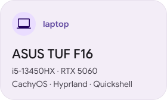
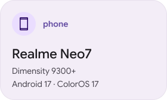
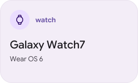

## langs

## frameworks & platforms

## ai & agents

## tooooools

---

## setup

<picture><source media="(prefers-color-scheme: dark)" srcset="assets/setup-laptop-dark.svg"></picture>
<picture><source media="(prefers-color-scheme: dark)" srcset="assets/setup-phone-dark.svg"></picture>
<picture><source media="(prefers-color-scheme: dark)" srcset="assets/setup-watch-dark.svg"></picture>

